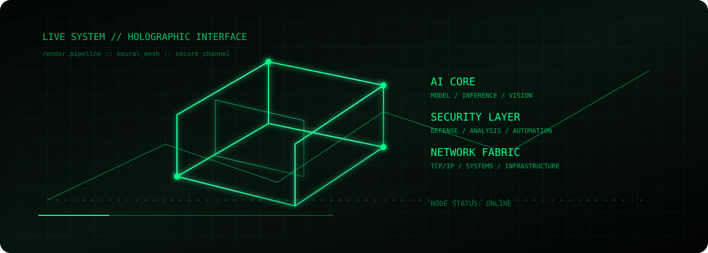
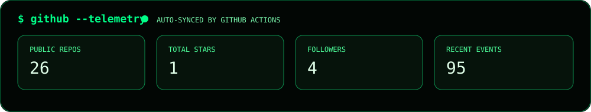
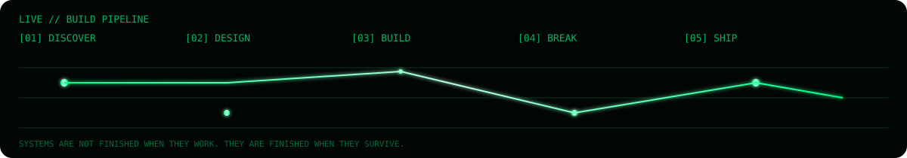

# <samp>~/sujeeth</samp> 

<p align="center">
  
</p>

<p align="center">
  <samp><b>ENGINEERING INTELLIGENCE • SECURING THE FUTURE</b></samp>
</p>

<p align="center">
  <a href="https://sujeeth777.github.io/"></a>
  <a href="https://github.com/sujeeth777"></a>
  <a href="https://www.linkedin.com/in/sri-sujeeth-213593302"></a>
  <a href="https://www.credly.com/users/sri-sujeeth-sirivella"></a>
</p>

<p align="center">
  
  
</p>

---

## <samp>$ whoami</samp>

> **Sri Sujeeth Sirivella** — Computer Science undergraduate building practical systems across **AI, cybersecurity, networking and software engineering**.

- 🎓 B.Tech CSE — Karunya Institute of Technology and Sciences
- 🗓️ Graduation: **2028**
- ⚙️ Current focus: **AI × Cybersecurity × Networking**
- 🧬 Research direction: **Post-Quantum Cryptography**
- 🧪 I like building things that are easier to demonstrate than explain.
- 🟢 Status: **OPEN TO INTERNSHIP OPPORTUNITIES**

<p align="center">
  
</p>

<p align="center">
  
</p>

## <samp>$ github --telemetry</samp>

<p align="center">
  
</p>

<p align="center">
  <samp>AUTO-SYNCED • GITHUB ACTIONS • 6-HOUR TELEMETRY CYCLE</samp>
</p>

## <samp>$ cat /etc/stack</samp>

<table>
<tr>
<td valign="top" width="33%">

### <samp>01 // AI</samp>
```text
Machine Learning
Deep Learning
PyTorch
Scikit-learn
LLMs / Transformers
Data Analysis
```

</td>
<td valign="top" width="33%">

### <samp>02 // SECURITY</samp>
```text
Network Security
Web App Security
Phishing Analysis
Vulnerability Assessment
Linux
Security Automation
```

</td>
<td valign="top" width="33%">

### <samp>03 // ENGINEERING</samp>
```text
Python / JavaScript
TypeScript / React
Next.js / Node.js
Express / MongoDB
SQL / Git
Networking / TCP-IP
```

</td>
</tr>
</table>

## <samp>$ ./pipeline --live</samp>

<p align="center">
  
</p>

## <samp>$ ls -la ~/projects --featured</samp>

<table>
<tr>
<td width="50%" valign="top">

### 🛡️ AI Phishing URL Detector
ML-driven phishing URL analysis and detection.

<a href="https://github.com/sujeeth777/AI-Phishing-URL-Detector"></a>

</td>
<td width="50%" valign="top">

### ⚡ Prelight
NVIDIA-powered performance and inference engineering.

<a href="https://github.com/sujeeth777/prelight"></a>

</td>
</tr>
<tr>
<td width="50%" valign="top">

### 🧠 AI-Driven PQC Platform
Post-quantum security experimentation.

<a href="https://github.com/sujeeth777/AI-driven-post-quantum-security-platform"></a>

</td>
<td width="50%" valign="top">

### 🏥 Hospital DBMS
Database-driven hospital management engineering project.

<a href="https://github.com/sujeeth777/Hospital_Project_DBMS"></a>

</td>
</tr>
<tr>
<td width="50%" valign="top">

### 🌐 AllKnowDev
Visual engineering / developer information platform.

<a href="https://github.com/sujeeth777/allknowdev"></a>

</td>
<td width="50%" valign="top">

### 📈 Sujeeth Trading AI
Experimental AI-assisted market analysis.

<a href="https://github.com/sujeeth777/Sujeeth-Trading-AI"></a>

</td>
</tr>
</table>

## <samp>$ github --native-layer</samp>

```text
┌──────────────────────────────────────────────────────────────┐
│ PROFILE SYSTEMS — NATIVE GITHUB                              │
│                                                              │
│ [ PINNED REPOSITORIES ]  →  your six strongest projects      │
│ [ CONTRIBUTION GRAPH  ]  →  real activity over time          │
│ [ ACHIEVEMENTS        ]  →  earned GitHub milestones         │
│ [ ACTIVITY OVERVIEW   ]  →  contribution categories          │
│ [ PROFILE STATUS      ]  →  current availability             │
│                                                              │
│ These are rendered by GitHub itself — not simulated in HTML. │
└──────────────────────────────────────────────────────────────┘
```

## <samp>$ ./connect --channels</samp>

<p align="center">
  <a href="https://sujeeth777.github.io/"></a>
  <a href="https://www.linkedin.com/in/sri-sujeeth-213593302"></a>
  <a href="https://www.credly.com/users/sri-sujeeth-sirivella"></a>
</p>

## <samp>$ git status</samp>

```console
$ git status --short
 M curiosity
 M experiments
 M impossible_ideas
?? new_systems/
?? better_questions/
?? another_3am_project/

$ git log --oneline -5
build: something useful
research: something weird
fix: broke it better
experiment: measure first
ship: repeat
```

## <samp>$ tail -f /var/log/motivation</samp>

```text
[OK] Learn.
[OK] Build.
[OK] Break.
[OK] Understand why.
[OK] Rebuild.
[OK] Ship.

> The goal is not to look like an engineer.
> The goal is to become difficult to replace.
```

<details>
<summary><samp>▸ SYSTEM INFORMATION</samp></summary>

```yaml
identity:
  name: Sri Sujeeth Sirivella
  role: AI Engineer & Cybersecurity Enthusiast
  education: B.Tech CSE
  graduation: 2028

domains:
  - Artificial Intelligence
  - Cybersecurity
  - Networking
  - Software Engineering
  - Post-Quantum Cryptography

profile_engine:
  telemetry: github-actions
  refresh: every-6-hours
  visual_layer: repository-local-svg
  native_layer: github-profile
```

</details>

---

<p align="center">
  <samp>SESSION CLOSED // CONNECTION ENCRYPTED_</samp><br/>
  <sub>Handcrafted profile interface • <a href="https://sujeeth777.github.io/">open portfolio →</a></sub>
</p>