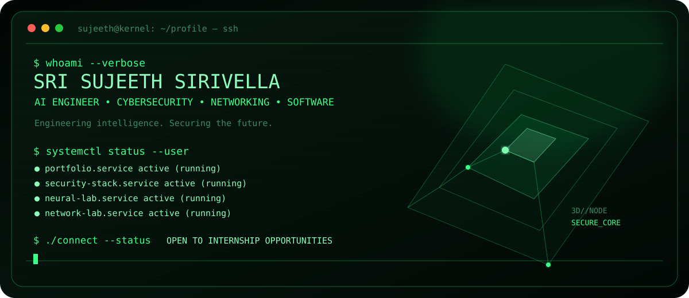
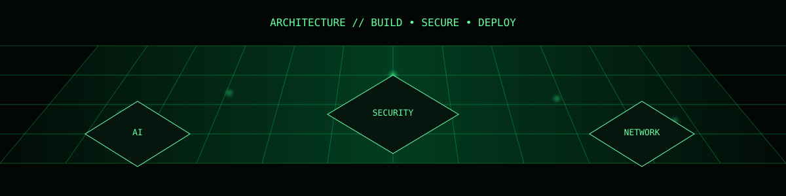

# <samp>~/sujeeth</samp> 

<p align="center">
  
</p>

<p align="center">
  <samp><b>ENGINEERING INTELLIGENCE • SECURING THE FUTURE</b></samp>
</p>

<p align="center">
  <a href="https://sujeeth777.github.io/"></a>
  <a href="https://github.com/sujeeth777"></a>
  <a href="https://www.linkedin.com/in/sri-sujeeth-213593302"></a>
  <a href="https://www.credly.com/users/sri-sujeeth-sirivella"></a>
</p>

---

## <samp>$ whoami</samp>

> **Sri Sujeeth Sirivella** — Computer Science undergraduate building practical systems across **AI, cybersecurity, networking and software engineering**.

- 🎓 B.Tech CSE — Karunya Institute of Technology and Sciences
- 🗓️ Graduation: **2028**
- ⚙️ Current focus: **AI × Cybersecurity × Networking**
- 🧪 I like building things that are easier to demonstrate than explain.
- 🟢 Status: **OPEN TO INTERNSHIP OPPORTUNITIES**

<p align="center">
  
</p>

<p align="center">
  
</p>

## <samp>$ cat /etc/stack</samp>

<table>
<tr>
<td valign="top" width="33%">

### <samp>01 // AI</samp>
```text
Machine Learning
Deep Learning
PyTorch
Scikit-learn
LLMs / Transformers
Data Analysis
```

</td>
<td valign="top" width="33%">

### <samp>02 // SECURITY</samp>
```text
Network Security
Web App Security
Phishing Analysis
Vulnerability Assessment
Linux
Security Automation
```

</td>
<td valign="top" width="33%">

### <samp>03 // ENGINEERING</samp>
```text
Python / JavaScript
TypeScript / React
Next.js / Node.js
Express / MongoDB
SQL / Git
Networking / TCP-IP
```

</td>
</tr>
</table>

## <samp>$ ./pipeline --live</samp>

<p align="center">
  
</p>

## <samp>$ ls -la ~/projects</samp>

| Project | What it does |
|---|---|
| **AI Phishing URL Detector** | ML-driven phishing URL analysis and detection |
| **TinyGPT-100K** | Compact language-model experimentation from the ground up |
| **FarmHub** | Full-stack agriculture platform with CRUD workflows |
| **Hospital Management System** | Web application for hospital operations |
| **Sujeeth Trading AI** | Experimental AI-assisted market analysis |
| **Prelight** | Performance engineering / inference optimization work |

> More projects live in the repositories below — this profile README is the **control panel**, not the entire lab.

<details>
<summary><samp>▸ INTERACTIVE TERMINAL // VISUAL MODULES</samp></summary>

```text
╭──────────────────────────────────────────────────────────────╮
│  3D CORE        ◉ AI       ◉ SECURITY       ◉ NETWORK       │
│                                                              │
│       ╱──────────────╲                                       │
│      ╱   NEURAL MESH   ╲      packets → → →                │
│     ╱────────────────────╲                                  │
│     │   inference node    │      defense node               │
│     ╲────────────────────╱                                  │
│      ╲──────────────────╱                                   │
│                                                              │
│  animation: ACTIVE    telemetry: LIVE    status: ONLINE     │
╰──────────────────────────────────────────────────────────────╯
```

The visual layer is built from repository-local SVGs, so the motion does not depend on a third-party widget.

</details>

## <samp>$ git status</samp>

```console
$ git status --short
 M curiosity
 M experiments
 M impossible_ideas
?? new_systems/
?? better_questions/
?? another_3am_project/

$ git log --oneline -5
build: something useful
research: something weird
fix: broke it better
experiment: measure first
ship: repeat
```

## <samp>$ ./connect --channels</samp>

- 🌐 **Portfolio:** https://sujeeth777.github.io/
- 💼 **LinkedIn:** https://www.linkedin.com/in/sri-sujeeth-213593302
- 🛡️ **Credly:** https://www.credly.com/users/sri-sujeeth-sirivella
- 💻 **GitHub:** https://github.com/sujeeth777

## <samp>$ tail -f /var/log/motivation</samp>

```text
[OK] Learn.
[OK] Build.
[OK] Break.
[OK] Understand why.
[OK] Rebuild.
[OK] Ship.

> The goal is not to look like an engineer.
> The goal is to become difficult to replace.
```

<details>
<summary><samp>▸ SYSTEM INFORMATION</samp></summary>

```yaml
identity:
  name: Sri Sujeeth Sirivella
  role: AI Engineer & Cybersecurity Enthusiast
  education: B.Tech CSE
  graduation: 2028

domains:
  - Artificial Intelligence
  - Cybersecurity
  - Networking
  - Software Engineering

build_style:
  - practical
  - experimental
  - security-minded
  - systems-oriented
```

</details>

---

<p align="center">
  <samp>SESSION CLOSED // CONNECTION ENCRYPTED_</samp><br/>
  <sub>Handcrafted profile interface • <a href="https://sujeeth777.github.io/">open portfolio →</a></sub>
</p>